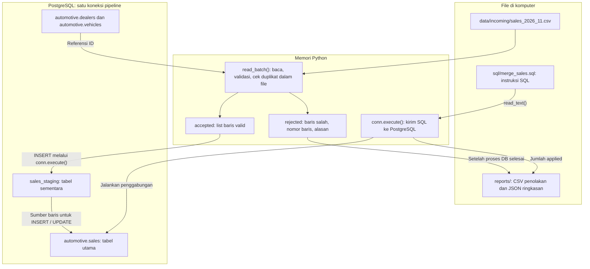
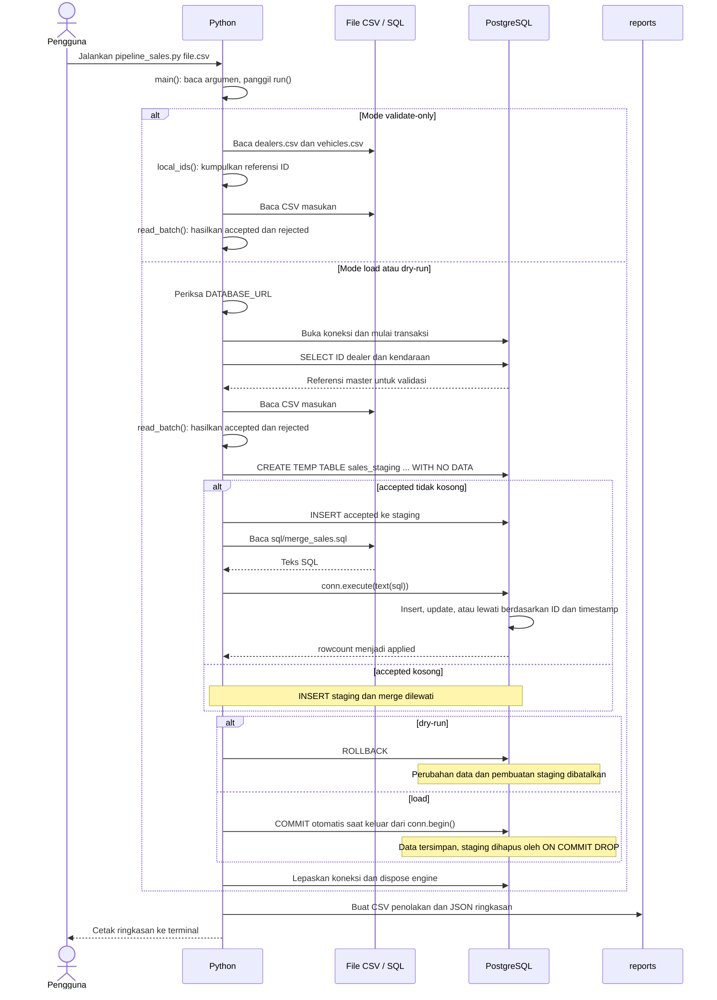
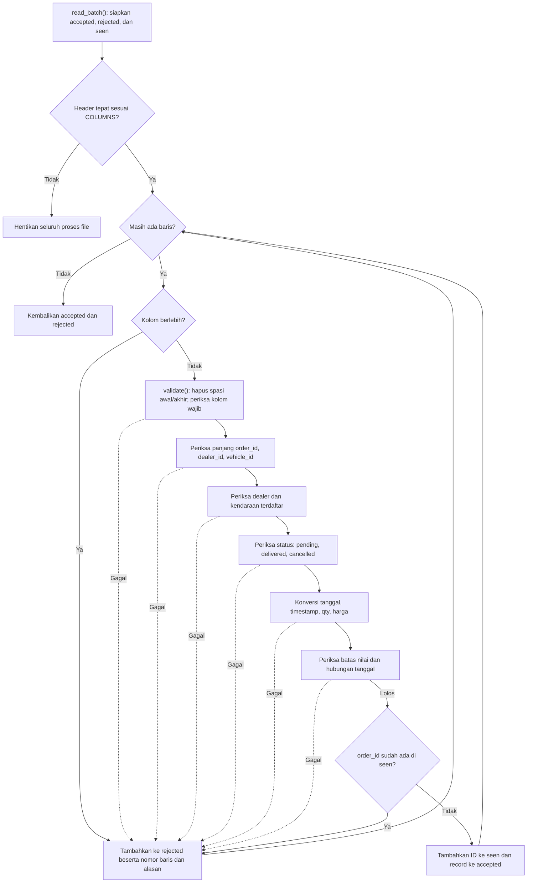
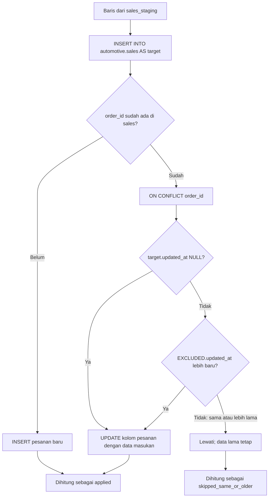
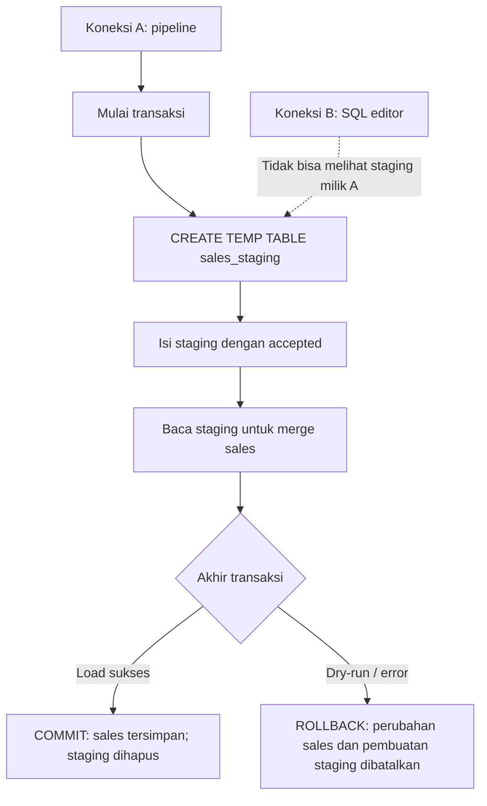

# Diagram pipeline penjualan

Dokumen ini mengikuti implementasi `pipeline_sales.py` dan `sql/merge_sales.sql`.
Untuk melihat versi diagram tanpa dukungan Mermaid, buka [pipeline-sales.html](pipeline-sales.html) di browser.

## 1. Tempat data berada



- `accepted` bukan tabel: ini list di RAM Python.
- `sales_staging` adalah tabel sementara di PostgreSQL, bukan file CSV.
- `automotive.sales` adalah tabel utama yang disimpan setelah commit.
- File SQL adalah teks instruksi. PostgreSQL menjalankan isinya ketika Python memanggil `conn.execute(text(sql))`.
- Pada `--validate-only`, referensi master dibaca dari CSV lokal dan seluruh bagian database dilewati.

## 2. Urutan pemanggilan dan transaksi



Diagram di atas menggambarkan proses berhasil. Jika ada kegagalan di dalam transaksi,
seluruh perubahan DB pada batch dibatalkan dan program berhenti sebelum tahap laporan.
Baris yang ditolak validasi tidak dianggap sebagai kegagalan seluruh batch.

## 3. Detail pemeriksaan setiap baris



Aturan di `validate()`:

| Pemeriksaan | Syarat |
|---|---|
| Kolom wajib | Semua kolom terisi, termasuk updated_at |
| Panjang ID | order_id maksimal 50; dealer_id dan vehicle_id maksimal 10 |
| Referensi master | ID dealer dan kendaraan ditemukan |
| Status | pending / delivered / cancelled |
| Tipe | order_date menjadi date; updated_at menjadi datetime; qty menjadi int; harga menjadi Decimal |
| Waktu | updated_at tanpa zona waktu; tanggalnya tidak sebelum order_date |
| Jumlah | 1 sampai 32.767 |
| Harga | Angka terbatas, lebih dari 0, kurang dari 10^18, maksimal dua angka desimal |

Pemeriksaan berhenti pada kesalahan pertama untuk setiap baris.
`seen` hanya menyimpan ID dari baris yang valid dan diterima: kemunculan valid pertama
dipakai. Kemunculan berikutnya ditolak, meskipun timestamp-nya lebih baru.
Set ini direset pada setiap pemanggilan `read_batch()`; bukan daftar seluruh ID dalam database.

## 4. Keputusan SQL ketika penggabungan



Ini gambaran keputusan per baris, bukan loop Python. Satu perintah SQL memproses seluruh staging.

```sql
INSERT INTO automotive.sales AS target (...)
SELECT ... FROM sales_staging
ON CONFLICT (order_id) DO UPDATE SET ...
WHERE target.updated_at IS NULL
   OR EXCLUDED.updated_at > target.updated_at;
```

- `target`: baris lama di tabel utama.
- `EXCLUDED`: baris masukan yang hendak dimasukkan tetapi berbenturan dengan ID lama.
- ID sudah ada bukan otomatis kesalahan: bisa merupakan pembaruan pesanan.
- Timestamp sama tetap dilewati walaupun isi kolom lain berbeda.
- Semua kolom pesanan pada bagian SET diganti ketika update, jadi CSV harus berisi data lengkap.
- Tidak ada aturan transisi status atau perubahan stok otomatis pada pipeline ini.

## 5. Umur staging dan batas koneksi



PostgreSQL menempatkan tabel sementara di schema sesi, misalnya `pg_temp_3`.
Nama schema dapat berbeda. Tidak perlu menulis nama schema itu dalam pipeline.
`SELECT * FROM automotive.sales WITH NO DATA` membuat staging dengan nama dan tipe kolom
hasil SELECT, tanpa menyalin baris. Ini bukan penyalinan seluruh constraint atau indeks tabel sales.
Seluruh perintah staging dan merge memakai objek `conn` yang sama.
Menjalankan `merge_sales.sql` sendirian pada SQL editor biasanya gagal karena staging belum ada pada sesi itu.

## 6. Perbandingan mode

| Tahap | --validate-only | --dry-run | Tanpa flag (load) |
|---|---|---|---|
| Referensi master | CSV lokal | PostgreSQL | PostgreSQL |
| Validasi Python | Ya | Ya | Ya |
| Buat staging | Tidak | Ya | Ya |
| Jalankan merge | Tidak | Jika accepted tidak kosong | Jika accepted tidak kosong |
| Simpan perubahan DB | Tidak | Tidak: rollback | Ya: commit |
| Tulis laporan | Ya, jika proses mencapai tahap laporan | Ya, jika proses mencapai tahap laporan | Ya, jika proses mencapai tahap laporan |

Pada validate-only, applied dan skipped_same_or_older bernilai null, karena tidak ada pengecekan terhadap sales.
Pada dry-run, applied adalah jumlah perubahan yang dicoba sebelum dibatalkan.

## 7. Contoh hasil dan impor ulang

Dengan data awal repo yang belum berubah, contoh 13 baris menghasilkan:

```text
13 baris CSV
  +-- 2 ditolak Python: qty negatif dan dealer tidak terdaftar
  +-- 11 diterima ke accepted
         +-- disalin ke sales_staging
                +-- 10 pesanan baru: INSERT
                +-- 1 pesanan lama: UPDATE ke delivered

Load:    11 applied, perubahan disimpan.
Dry-run: 11 applied, seluruh perubahan dibatalkan.
Impor ulang setelah load: 0 applied, 11 skipped_same_or_older.
```

Contoh satu update:

| Tempat | order_id | status | updated_at |
|---|---|---|---|
| sales sebelum impor | ORD-001 | pending | 2026-11-01 10:00:00 |
| CSV, kemudian accepted dan staging | ORD-001 | delivered | 2026-11-02 10:00:00 |
| sales setelah commit | ORD-001 | delivered | 2026-11-02 10:00:00 |

ORD-001 di atas ilustrasi. Pada CSV contoh repo, pesanan lama yang diperbarui adalah ORD-2025-003351.

## 8. Laporan dan kegagalan

| Kondisi | Hasil |
|---|---|
| Satu baris gagal validasi | Masuk rejected; baris lain tetap diproses |
| Semua baris ditolak | Mode DB tetap membuat staging kosong, melewati merge, lalu menulis laporan |
| Header salah / file tidak ditemukan | Program berhenti; laporan batch belum ditulis |
| Database gagal saat transaksi | Semua perubahan DB batch di-rollback; laporan batch belum ditulis |
| Penulisan laporan gagal setelah commit | Perubahan DB sudah tersimpan; laporan bisa tidak lengkap |

Nama laporan memuat waktu lokal dan potongan UUID untuk membedakan batch.
CSV penolakan menyimpan nilai masukan, nomor baris, dan alasan. JSON menyimpan mode,
path input, accepted, rejected, applied, skipped_same_or_older, dan path CSV penolakan.
Timestamp baris dan tanggal proses bukan hal yang sama: updated_at berasal dari CSV,
sedangkan waktu pada nama laporan menunjukkan waktu program dijalankan.

## 9. Peta fungsi dan file

| Fungsi / file | Tugas |
|---|---|
| main() | Baca argumen; panggil run(); tampilkan pesan jika gagal |
| run() | Atur mode, koneksi, transaksi, staging, merge, dan laporan |
| local_ids() | Ambil referensi dari CSV lokal untuk validate-only |
| read_batch() | Baca header dan baris; panggil validate(); cek duplikat file |
| validate() | Periksa dan konversi satu baris |
| sql/merge_sales.sql | Aturan insert/update berdasarkan order_id dan updated_at |
| tests/test_pipeline_sales.py | Tes validasi dan parsing; belum menguji PostgreSQL |
| load_data.py | Loader data awal; terpisah dari pipeline tambahan ini |
| sql/create_table.sql | Setup schema dan tabel utama; tidak otomatis dijalankan pipeline |

Staging di implementasi ini berfungsi sebagai tempat singgah bagi SQL merge.
Validasi dilakukan di Python. Untuk pipeline sederhana ini, upsert langsung dari Python
juga mungkin; staging dipertahankan sebagai contoh belajar pemrosesan melalui tabel sementara.
